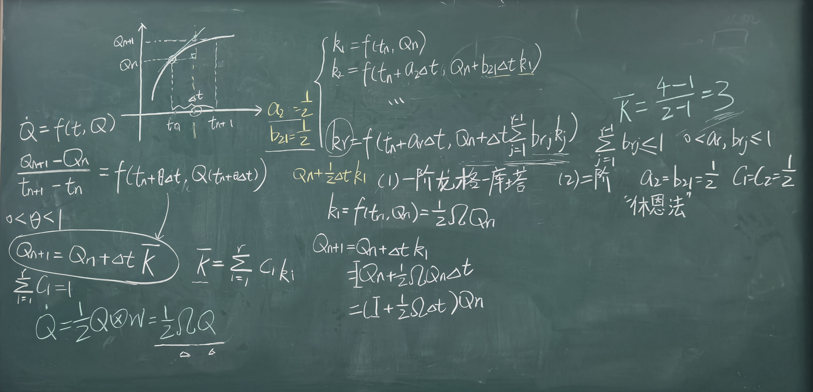

# 陀螺仪与地磁数据采集及处理（二）：四元数微分方程求解与离散更新算法

@ LIANG Yinshi

## 一、 四元数运动学微分方程的求解框架

在上一课时中，我们通过飞机当前的四元数姿态和陀螺仪测到的角速度，导出了当前t时刻四元数姿态的变化率（导数），也就是四元数运动学微分方程：
$$
\dot{Q}(t) = \frac{1}{2} \Omega Q(t)
$$
其中 $Q$ 是t时刻机体的四元数姿态；

斜对称矩阵 $\Omega$ 包含陀螺仪测的三轴角速度测量值 $(p, q, r)$：

$$\Omega = \begin{bmatrix} 0 & -p & -q & -r \\  p & 0 & r & -q \\  q & -r & 0 & p \\  r & q & -p & 0 \end{bmatrix}$$

现在知道了瞬时的变化率。我们更想知道的是，在极短时间 $\Delta t$ 后，新的四元数姿态 $Q_{n+1}$ 会是怎么样的，如何用 $Q$ 表示，写成一个递推式。而这个问题的本质就是解上面的微分方程。

在采样周期 $\Delta t = t_{n+1} - t_n$ 极短的情况下，可假设陀螺仪测得的角速度 $\Omega$ 为常数。该微分方程属于**齐次常系数线性微分方程**，其精确解析解可以通过矩阵指数给出。

## 二、 矩阵指数解析推导与泰勒级数展开

### 2.1 求解微分方程

设 $A = \frac{1}{2}\Omega$，则方程化简为：

$$\dot{Q}(t) - A Q(t) = 0$$

然后凑微分，两边同左乘积分因子 $e^{-At}$：

$$e^{-At} \dot{Q}(t) - e^{-At} A Q(t) = 0 \implies \frac{\mathrm{d}(e^{-At} Q(t))}{\mathrm{d}t} = 0$$

在时间区间 $[t_n, t_{n+1}]$ 上进行定积分：

$$\int_{t_n}^{t_{n+1}} \frac{\mathrm{d}(e^{-At} Q(t))}{\mathrm{d}t} \mathrm{d}t = 0 \implies e^{-A t_{n+1}} Q(t_{n+1}) = e^{-A t_n} Q(t_n)$$

两边同左乘 $e^{A t_{n+1}}$，利用指数运算法则 $e^{A t_{n+1}} e^{-A t_n} = e^{A(t_{n+1} - t_n)} = e^{A \Delta t}$，解得**解析更新递推式**：
$$
Q(t_{n+1}) = e^{A \Delta t} Q(t_n) = e^{\frac{1}{2} \Omega \Delta t} Q(t_n)
$$

### 2.2 矩阵指数的展开与近似求解

根据矩阵指数函数的泰勒级数定义：

$$e^{A} = I + A + \frac{A^2}{2!} + \frac{A^3}{3!} + \dots$$

代入 $A = \frac{1}{2}\Omega \Delta t$ 展开：

$$e^{\frac{1}{2}\Omega \Delta t} = I + \frac{1}{2}\Omega \Delta t + \frac{1}{2!}\left(\frac{1}{2}\Omega \Delta t\right)^2 + \frac{1}{3!}\left(\frac{1}{2}\Omega \Delta t\right)^3 + \dots$$

根据实际飞控计算精度的需求，通常有以下三种离散更新近似方法：

### 2.3 常用三种离散更新近似方法

#### 1. 一阶毕卡近似（一阶欧拉法）

仅截取级数前两项（忽略二次及高阶项）：

$$Q(t_{n+1}) \approx \left( I + \frac{1}{2} \Omega \Delta t \right) Q(t_n)$$

写成矩阵与列向量相乘的离散形式：

$$\begin{bmatrix} q_0' \\ q_1' \\ q_2' \\ q_3' \end{bmatrix} = \begin{bmatrix} 1 & -\frac{1}{2}p\Delta t & -\frac{1}{2}q\Delta t & -\frac{1}{2}r\Delta t \\ \frac{1}{2}p\Delta t & 1 & \frac{1}{2}r\Delta t & -\frac{1}{2}q\Delta t \\ \frac{1}{2}q\Delta t & -\frac{1}{2}r\Delta t & 1 & \frac{1}{2}p\Delta t \\ \frac{1}{2}r\Delta t & \frac{1}{2}q\Delta t & -\frac{1}{2}p\Delta t & 1 \end{bmatrix} \begin{bmatrix} q_0 \\ q_1 \\ q_2 \\ q_3 \end{bmatrix}$$

展开为标量递推等式：

$$\begin{cases} q_0' = q_0 - \frac{1}{2}p\Delta t q_1 - \frac{1}{2}q\Delta t q_2 - \frac{1}{2}r\Delta t q_3 \\ q_1' = q_1 + \frac{1}{2}p\Delta t q_0 + \frac{1}{2}r\Delta t q_2 - \frac{1}{2}q\Delta t q_3 \\ q_2' = q_2 + \frac{1}{2}q\Delta t q_0 - \frac{1}{2}r\Delta t q_1 + \frac{1}{2}p\Delta t q_3 \\ q_3' = q_3 + \frac{1}{2}r\Delta t q_0 + \frac{1}{2}q\Delta t q_1 - \frac{1}{2}p\Delta t q_2 \end{cases}$$

#### 2. 二阶泰勒展开近似

计算矩阵 $\Omega^2$：

$$\Omega^2 = \begin{bmatrix} -(p^2+q^2+r^2) & 0 & 0 & 0 \\  0 & -(p^2+q^2+r^2) & 0 & 0 \\  0 & 0 & -(p^2+q^2+r^2) & 0 \\  0 & 0 & 0 & -(p^2+q^2+r^2) \end{bmatrix}$$

定义角速度模长 $W_m = \sqrt{p^2 + q^2 + r^2}$，则有：

$$\Omega^2 = -W_m^2 I$$

代入级数前三项，即得到**二阶更新近似**：

$$Q(t_{n+1}) \approx \left( I + \frac{1}{2}\Omega \Delta t + \frac{1}{8}\Omega^2 \Delta t^2 \right) Q(t_n)$$

#### 3. 三角函数闭式极值展开（欧拉公式推导）

利用 $\Omega^2 = -W_m^2 I$，可将奇数项和偶数项归类整理为余弦和正弦级数：

$$e^{\frac{1}{2}\Omega \Delta t} = \left( I - \frac{1}{2!}\left(\frac{1}{2}W_m \Delta t\right)^2 + \frac{1}{4!}\left(\frac{1}{2}W_m \Delta t\right)^4 - \dots \right) I + \left( \frac{1}{2}W_m \Delta t - \frac{1}{3!}\left(\frac{1}{2}W_m \Delta t\right)^3 + \dots \right) \frac{\Omega}{W_m}$$

整理写成闭式解（闭合高精度形式）：

$$e^{\frac{1}{2}\Omega \Delta t} = \cos\left(\frac{W_m \Delta t}{2}\right) I + \sin\left(\frac{W_m \Delta t}{2}\right) \frac{\Omega}{W_m}$$

> **本质联系**：利用欧拉公式 $e^{ix} = \cos x + i \sin x$ 类比，可写出四元数指数表达：
>
> $$q = \cos\frac{\theta}{2} + u \sin\frac{\theta}{2} \iff q = e^{\frac{\theta}{2} u} \quad (u^2 = -1)$$

## 三、 数值微分求解：龙格-库塔算法（Runge-Kutta）

对于一般一阶常微分方程 $\dot{Q} = f(t, Q)$，当角速度变化剧烈时，采用数值积分算法能获得更好的稳定性和精度。

### 3.1 龙格-库塔法通式

通过在区间 $[t_n, t_{n+1}]$ 内选取多个点的斜率 $k_i$ 进行加权平均来估计步长：

$$Q_{n+1} = Q_n + \Delta t \bar{K}, \quad \text{其中 } \bar{K} = \sum_{i=1}^{r} c_i k_i \quad \left(\sum_{i=1}^{r} c_i = 1\right)$$

- **一阶龙格-库塔（欧拉法）**：

  $$k_1 = f(t_n, Q_n) = \frac{1}{2} \Omega Q_n \implies Q_{n+1} = Q_n + \Delta t k_1 = \left( I + \frac{1}{2}\Omega\Delta t \right) Q_n$$

- **二阶龙格-库塔（休恩法 / Heun's Method）**：

  在节点中选取中点 $a_2 = b_{21} = \frac{1}{2}$，权重系数 $c_1 = 0, c_2 = 1$（或 $c_1 = c_2 = \frac{1}{2}$）：

  $$\begin{cases} k_1 = f(t_n, Q_n) \\ k_2 = f\left(t_n + \frac{1}{2}\Delta t, Q_n + \frac{1}{2}\Delta t k_1\right) \end{cases}$$

### 3.2 离散化算子后的四元数归一化处理

无论采用一阶欧拉法、高阶泰勒展开还是龙格-库塔算法，在经过数值离散更新后，得到的 $Q(t_{n+1})$ 都会因为截断误差和浮点计算误差而逐渐丧失**单位四元数**的约束条件（即 $\Vert{}Q\Vert{} \neq 1$）。

因此，在嵌入式微控制器每一步完成姿态更新后，**必须强制进行归一化修正**：

$$Q(t_{n+1}) \leftarrow \frac{Q(t_{n+1})}{\Vert{}Q(t_{n+1})\Vert{}}$$

### 3.1 为什么需要数值微分求解？

在理想情况下，如果我们假设在极短的时间步长 $\Delta t$ 内，陀螺仪测得的角速度 $\Omega$ 是绝对恒定的常数，我们可以写出解析解 $Q(t_{n+1}) = e^{\frac{1}{2}\Omega \Delta t} Q(t_n)$。

但在真实的飞控系统（如四轴无人机高频姿态解算）中，

1. **角速度是动态变化的**：无人机在高速翻转或受风干扰时，角速度 $\Omega(t)$ 在 $\Delta t$ 内部也是剧烈变化的，不是常数。
2. **截断误差与数值漂移**：用简单的前向欧拉法（一阶近似）会带来较大的累积误差，导致姿态估计发生漂移。

因此，我们需要用数学上更严谨的**数值微分求解器——龙格-库塔法（Runge-Kutta）**，在 $\Delta t$ 时间段内采样多个点的斜率进行“加权平均”，来精确估计这一个步长内的实际姿态变化。

### 3.2 龙格-库塔法通式

假设我们要求解微分方程：
$$
\dot{Q} = f(t, Q) = \frac{1}{2} \Omega(t) Q
$$

- **欧拉法（前向斜率）**：只取起点 $t_n$ 处的斜率（切线方向），沿着这个方向走 $\Delta t$ 距离。如果曲线弯曲度大，预测终点 $Q_{n+1}$ 就会严重偏离实际曲线。
- **中点法/中值定理**：在区间 $[t_n, t_{n+1}]$ 中间（如 $t_n + \frac{1}{2}\Delta t$）采样一个点，用中间点的斜率来替代整段曲线的平均斜率，误差会骤降。

龙格-库塔法的基本递推结构为：
$$
Q_{n+1} = Q_n + \Delta t \cdot \bar{K}
$$
其中 $\bar{K}$ 是在区间 $[t_n, t_{n+1}]$ 内多个节点斜率 $k_i$ 的**加权平均**：

$$\bar{K} = \sum_{i=1}^{r} c_i k_i \quad \left( \text{加权约束条件：} \sum_{i=1}^{r} c_i = 1 \right)$$

各个节点斜率 $k_i$ 的递推通式（即上图中的 $k_r$ 公式）：

$$k_1 = f(t_n, Q_n)$$

$$k_2 = f\left(t_n + a_2 \Delta t, \; Q_n + b_{21} \Delta t \cdot k_1\right)$$

$$k_3 = f\left(t_n + a_3 \Delta t, \; Q_n + \Delta t (b_{31} k_1 + b_{32} k_2)\right)$$

$$\vdots$$

$$k_r = f\left(t_n + a_r \Delta t, \; Q_n + \Delta t \sum_{j=1}^{r-1} b_{rj} k_j\right)$$

- $a_r$：时间节点的试探位置比例（如 $0, \frac{1}{2}, 1$）。
- $b_{rj}$：利用前面求出的斜率 $k_j$ 来估计当前点状态的权重系数。
- $c_i$：最终组合各斜率时的加权系数。

### 3.1 常用阶数的具体展开与飞控推导

根据采样的斜率节点个数 $r$，龙格-库塔法分为不同的阶数（阶数越高，截断误差越小，精度越高）。

#### 1. 一阶龙格-库塔法（1st-order RK / 前向欧拉法）

- **参数设置**：只取 $r=1$ 个斜率节点，$c_1 = 1$。

- **斜率计算**：

  $$k_1 = f(t_n, Q_n) = \frac{1}{2} \Omega_n Q_n$$

- **更新公式**：

  $$Q_{n+1} = Q_n + \Delta t \cdot k_1 = Q_n + \frac{1}{2} \Omega_n Q_n \Delta t = \left( I + \frac{1}{2} \Omega_n \Delta t \right) Q_n$$

这就是我们上一节课导出的**一阶毕卡近似（前向欧拉递推）**，计算量最小，但精细度也最低。

#### 2. 二阶龙格-库塔法（2nd-order RK / 休恩法 Heun's Method）

以以下参数为例：$a_2 = \frac{1}{2}, b_{21} = \frac{1}{2}, c_1 = \frac{1}{2}, c_2 = \frac{1}{2}$。

##### 步骤一：计算起点斜率 $k_1$

$$k_1 = f(t_n, Q_n) = \frac{1}{2} \Omega(t_n) Q_n$$

##### 步骤二：利用 $k_1$ 预估中点/终点状态，计算第二个斜率 $k_2$

选取中点时间 $t_n + \frac{1}{2}\Delta t$，预测中点姿态 $\tilde{Q}_{mid} = Q_n + \frac{1}{2}\Delta t \cdot k_1$：

$$k_2 = f\left(t_n + \frac{1}{2}\Delta t, \; Q_n + \frac{1}{2}\Delta t \cdot k_1\right) = \frac{1}{2} \Omega\left(t_n + \frac{1}{2}\Delta t\right) \left( Q_n + \frac{1}{2}\Delta t \cdot k_1 \right)$$

##### 步骤三：加权组合更新

代入 $Q_{n+1} = Q_n +  \bar{k} = Q_n + \Delta t \cdot (\frac{1}{2}k_1 + \frac{1}{2}k_2)$（若取 $c_1 = \frac{1}{2}, c_2 = \frac{1}{2}$） ：

得到 $$Q_{n+1} = \left( I + \frac{1}{2}\Omega \Delta t + \frac{1}{8} \Omega^2 \Delta t^2 \right) Q_n$$

**结论**：二阶龙格-库塔法在数学推导上**等价于泰勒展开的前三项（二阶泰勒展开）**。

#### 3. 经典四阶龙格-库塔法（4th-order RK / RK4）

在高端无人机或 APM / PX4 飞控算法中，为了在极高动态旋转下保持姿态求解的绝绝对准确，常用 **RK4 算法**。

它在区间内采样 4 个斜率节点：

1. **$k_1$（起点斜率）**：

   $$k_1 = \frac{1}{2} \Omega(t_n) Q_n$$

2. **$k_2$（前半程中点斜率，用 $k_1$ 预测）**：

   $$k_2 = \frac{1}{2} \Omega\left(t_n + \frac{\Delta t}{2}\right) \left( Q_n + \frac{\Delta t}{2} k_1 \right)$$

3. **$k_3$（后半程中点斜率，用 $k_2$ 修正）**：

   $$k_3 = \frac{1}{2} \Omega\left(t_n + \frac{\Delta t}{2}\right) \left( Q_n + \frac{\Delta t}{2} k_2 \right)$$

4. **$k_4$（终点斜率，用 $k_3$ 预测）**：

   $$k_4 = \frac{1}{2} \Omega(t_n + \Delta t) \left( Q_n + \Delta t \cdot k_3 \right)$$

##### 经典加权平均（Simpsons 权重 $\frac{1}{6}, \frac{2}{6}, \frac{2}{6}, \frac{1}{6}$）：

$$Q_{n+1} = Q_n + \frac{\Delta t}{6} \left( k_1 + 2k_2 + 2k_3 + k_4 \right)$$

> 26.10.15