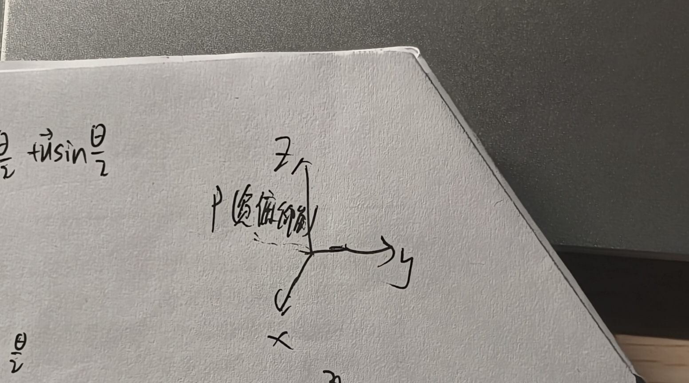
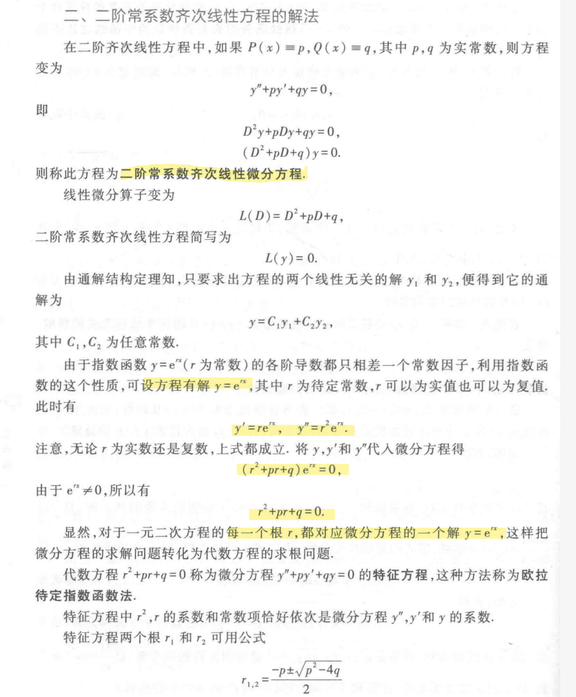
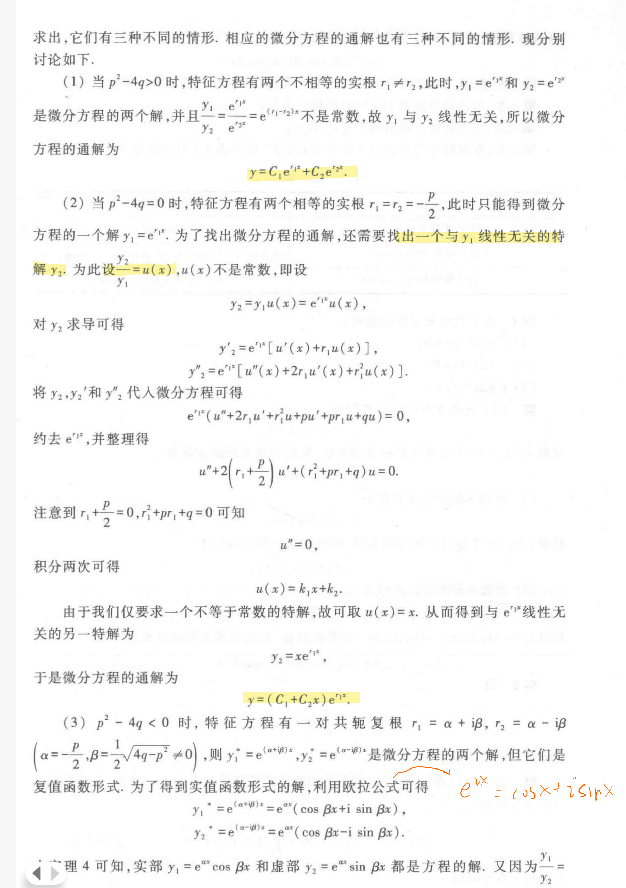
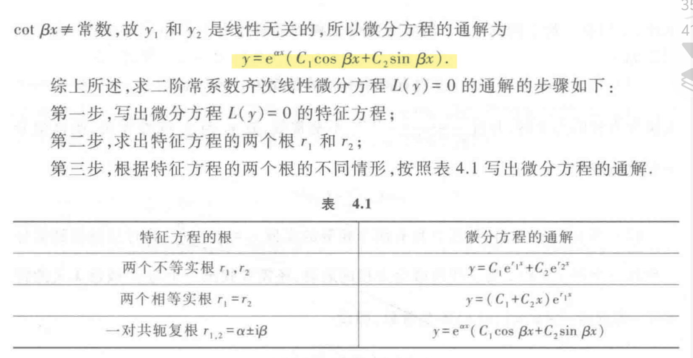

# 四轴飞行器 PID 姿态反馈控制


## 一、 为什么我们需要PID控制？

在介绍 PID 控制之前，我们先来了解一下，为什么四轴飞行器通常采用闭环控制。

理论上，如果我们能够准确建立飞行器的动力学模型，掌握它的初始状态，并准确预测飞行过程中受到的各种扰动，就可以提前计算出所需的电机控制指令，实现开环控制。

但在实际飞行中，外部扰动、电机响应误差以及模型不准确等因素，都可能导致飞行器的实际运动偏离预期。如果完全依靠模型进行预测和补偿，就需要付出很高的建模、测量和计算成本。

闭环控制则提供了另一种思路：我们持续测量飞行器的实际姿态，将它与目标姿态进行比较，根据产生的误差调整电机输出。这样就不必准确预测每一种扰动，而是可以根据实际运动结果进行修正。

当然，闭环控制并不能消除所有误差，但它能够提高系统对模型误差和外部扰动的适应能力，因此非常适合四轴飞行器的姿态控制。

那么，知道了姿态误差之后，究竟应该施加多大的纠正力度？如何兼顾响应速度、稳态精度和运动过程中的稳定性？这就是接下来我们要介绍的 PID 控制。


以姿态为例，PID控制要做的，就是发现当前姿态和目标有偏差，要尝试纠正，PID控制的是如何来抵达目标的问题。

- **我们想做的是什么？**控制飞机的姿态，把飞机的姿态调整成我们目标的姿态。

- **我们知道的是什么？**飞机 t 时刻的姿态和我们目标的姿态。

  我们以四轴飞行器的姿态角控制（以俯仰角 $\theta$ 为例）为例：

  - **期望状态（$r(t)$）**：遥控器手柄给出的期望俯仰角 $\theta_{0}$（例如 $0^\circ$ 悬停）。

  - **测量状态（$y(t)$）**：IMU 经过姿态解算得到的当前实际俯仰角 $\theta$。

  我们定义系统在 $t$ 时刻的控制误差为：

  $$e(t) = r(t) - y(t) = \theta_0(t) - \theta(t)$$

- **我们有的是什么？**我们能控制电机的转速，进而产生一个力矩 $M(t)$ 去纠正当前的姿态。

**控制的核心任务**：寻找一个控制律，根据误差 $e(t)$ 计算出合理的控制量 $M(t)$（最终映射为电机的期望转速或 PWM 信号），使得系统在面对外界扰动时，误差 $e(t)$ 能迅速、平稳、无残留地趋近于 $0$。


那么，对于当前的一个误差 e(t)，应该施加多大的力矩才能把这个误差减小到 0 呢？我们能不能写出来一个公式，来合理地表示误差et与力矩Mt之间的关系呢？这个就是我们PID控制的任务。


在探讨这个问题之前，我们首先明确一些前置知识，最简单的一个**转动版牛顿第二定律**。

- **平动**：$F = m \cdot a = m \cdot \ddot{x}$（力 $F$ 产生线加速度 $a$）
- **转动**：$M = I \cdot \alpha = I \cdot \ddot{\theta}$（力矩 $M$ 产生角加速度 $\alpha$）

对于四轴飞行器（以 Pitch 轴俯仰角 $\theta$ 为例）：

- $\theta(t)$ 是飞行器当前的**实际姿态角**，$\theta_0$ 是我们期望的**目标姿态角**（如 $0^\circ$ 悬停）。
- $I$ 是飞行器绕该轴的**转动惯量**（由质量分布决定）。
- $M(t)$ 是左右/前后电机产生差速时施加给机身的**合力矩**（这是我们能直接控制的物理量）。
- 定义 $t$ 时刻的姿态偏差为：$e(t) = \theta_0 - \theta(t)$


## 二、 PID控制器的理论演进与推导

经典的 PID（Proportional-Integral-Derivative）控制器给出了极具物理直觉且数学上完备的解答：**从“现在”、“过去”和“未来”三个时间维度来协同处理误差。**

PDI顺序：动起来，稳起来，准起来

### 1. P控制（比例控制 Proportional）

我们首先可以想到的是，当前姿态距离目标姿态越远，误差越大，我们施加的力矩就应该越大，这是很自然的想法。误差小，我们就轻轻“推”（施加力矩）；误差大，推的就重一些。


我们可以从最简单的数学关系入手：**力矩与误差成正比**。
$$
M(t) = K_p e(t)
$$
这里我们定义的e(t)是测量角减去目标角。由于我们这里以绕某一固定轴的转动为例，此时我们就暂且把这个公式看成一个标量公式，左边的力矩是它在这个方向上的分量。方向上误差和力矩一致，所以 $K_p>0$。

> 可以讨论一下方向的问题。如果建立常见的坐标系，抬头产生的俯仰角是正的还是负的？（实际是负的）
>
> 

- **这样做的结果是什么呢**？

  > 给大家 5 分钟时间，请同学们计算一下

将 $M(t) = I \cdot \ddot{\theta}(t)$ 代入上式：

$$I \cdot \ddot{\theta}(t) = K_p \cdot (\theta_0 - \theta(t))$$

整理得到关于姿态角 $\theta(t)$ 的二阶常系数齐次线性微分方程：

$$\ddot{\theta}(t) + \frac{K_p}{I} \cdot \theta(t) = \frac{K_p}{I} \cdot \theta_0$$

设初始条件为：飞行器从偏斜角 $\theta(0) = A + \theta_0$ 静止释放（$\dot{\theta}(0) = 0$），解此微分方程可得：

$$\theta(t) = \theta_0 + A \cos(\omega t)$$

其中，系统的自然旋转角频率为：$\omega = \sqrt{\frac{K_p}{I}}$

微分方程的解明确表明：**纯 P 控制下，四轴飞行器会在目标角度 $\theta_0$ 两侧做永不停息的“角简谐运动”**

- **为什么会这样？**

  纯 P 控制只看“当前角度在哪里”。当飞行器向目标角度 $\theta_0$ 回正时，随着误差减小，力矩 $M(t)$ 在减小，但**方向一直没变**（始终在加速回正）。

  当达到目标角度 $\theta_0$ 时，虽然 $e(t)=0$ 使得力矩归零，但此时**角速度达到了最大值**！巨大的旋转惯性会冲过头，导致飞行器在另一侧继续过冲，产生剧烈的来回晃动与振荡。

  类似弹簧。

  
  
  ==演示==
  
  
  
  
  
  > 待补充：这些参数大概是多少？
  
  
  
  > 给大家5分钟时间，让大家理解一下。
  
  

## 2. D 控制（微分控制 Derivative）

### 2.1 思路引入：如何刹车？

为了防止过冲，我们自然地想到，可以根据当前的角速度加入制动机制。当旋转太快时，提前反向打力矩进行“刹车”，来抑制当前过高的角速度。当前角速度越大，这个抑制的力矩就越大，可以假设成正比：

$$M(t) = K_p \cdot e(t) - K_d \cdot \omega(t)$$ 

> 解释一下为什么KP前面是正号，KD前面是负号。
>
> KP是正的，我们为了方便把KD也定义成正的。这一项本质上是一个阻尼项。在离目标越来越接近的时候，角速度会越来越大，这个时候就需要逐渐施加越来越大的阻尼力矩来抑制角速度。

由于 $\frac{de}{dt} = \frac{d(\theta_0-\theta)}{dt} = -\frac{d\theta}{dt} = -\omega(t)$

故 $M(t) = K_p \cdot e(t) - K_d \cdot \dot{\theta}(t) = K_p \cdot e(t) + K_d \cdot \dot{e}(t) $


但是这种思路真的可以让它停下来吗？我们是实践的信徒，大家来实践性的推导一下。

**这样做的结果是什么呢**？

> 给大家 5 分钟时间，请同学们计算一下


### 2.2 数学推导：阻尼微分方程

现在，我们把带有阻尼的总力矩 $M(t) = K_p(\theta_0 - \theta) - K_d \dot{\theta}(t)$，代回转动动力学方程 $M = I \cdot \ddot{\theta}$ 中：

$$I \cdot \ddot{\theta}(t) = K_p \cdot (\theta_0 - \theta(t)) - K_d \cdot \dot{\theta}(t)$$

将含有 $\theta$ 的项全部移到左边，常数项留在右边，并将两边同时除以转动惯量 $I$：

$$\ddot{\theta}(t) + \frac{K_d}{I} \dot{\theta}(t) + \frac{K_p}{I} \theta(t) = \frac{K_p}{I} \theta_0$$

**为什么加了中间这一项 $\frac{K_d}{I} \dot{\theta}(t)$，系统就不会像纯 P 控制那样无限振荡了？**

在纯 P 控制时，方程是 $\ddot{\theta} + \frac{K_p}{I}\theta = \text{常数}$，特征方程的解是纯虚数 $\pm i\omega$，代表**没有能量衰减的余弦波（简谐运动）**。

而现在，根据微积分求解常系数线性微分方程的标准方法，我们设解的形式为 $\theta(t) = C e^{r t}$，代入齐次方程得到**特征方程**：

$$r^2 + \frac{K_d}{I} r + \frac{K_p}{I} = 0$$

用一元二次方程求根公式解出 $r$：

$$r = \frac{-\frac{K_d}{I} \pm \sqrt{\left(\frac{K_d}{I}\right)^2 - 4\frac{K_p}{I}}}{2}$$

为了式子更简洁，我们令 $\alpha = \frac{K_d}{2I} > 0$（代表衰减速率参数）。判别式 $\Delta = \left(\frac{K_d}{I}\right)^2 - 4\frac{K_p}{I}$ 的正负，直接决定了数学解的形式与物理运动状态。


#### 1. 情况 1：欠阻尼（$\Delta < 0$，即 $K_d < 2\sqrt{K_p I}$）

设阻尼频率 $\omega_d = \frac{1}{2}\sqrt{4\frac{K_p}{I} - \left(\frac{K_d}{I}\right)^2}$，特征根为共轭复根 $r_{1,2} = -\alpha \pm i \omega_d$。

包含特解 $\theta_0$ 的通解形式为：

$$\theta(t) = \theta_0 + e^{-\alpha t} \left( C_1 \cos(\omega_d t) + C_2 \sin(\omega_d t) \right)$$

**代入初始条件求解常数**：

1. **代入角度条件**：

   $$\theta(0) = \theta_0 + e^0 (C_1 \cdot 1 + 0) = \theta_0 + C_1 = \theta_0 + A \implies C_1 = A$$

2. **求一阶导数**：

   $$\frac{\mathrm{d}\theta(t)}{\mathrm{d}t} = -\alpha e^{-\alpha t} (C_1 \cos(\omega_d t) + C_2 \sin(\omega_d t)) + e^{-\alpha t} (-\omega_d C_1 \sin(\omega_d t) + \omega_d C_2 \cos(\omega_d t))$$

3. **代入角速度条件 $\frac{\mathrm{d}\theta(0)}{\mathrm{d}t} = 0$**：

   $$\frac{\mathrm{d}\theta(0)}{\mathrm{d}t} = -\alpha C_1 + \omega_d C_2 = 0 \implies C_2 = \frac{\alpha A}{\omega_d}$$

**特解表达**：

$$\theta(t) = \theta_0 + A \cdot e^{-\frac{K_d}{2I} t} \left( \cos(\omega_d t) + \frac{K_d}{2 I \omega_d} \sin(\omega_d t) \right)$$

- **物理本质**：包含余弦波与衰减项 $e^{-\alpha t}$。飞行器**穿过目标角度产生过冲与来回震荡，但由于阻尼不断吸收能量，振幅等比衰减，最终停在 $\theta_0$**。

> 为什么物理上会“过冲并震荡”？

看看上面的数学表达式，它由两部分乘积组成：

- **$\cos(\omega_d t + \phi)$（正弦/余弦周期波）**：由于阻尼 $K_d$ 太小，不足以在飞行器到达 $0^\circ$ 前把旋转动能完全吸收。飞行器冲过头后，P 项（弹簧力）开始反向拉，又把它拉回来，导致物理上必然产生**来回晃动**。
- **$e^{-\alpha t}$（衰减因子）**：因为 $\alpha = \frac{K_d}{2I} > 0$，所以指数项是一个随着时间 $t$ 增加而逐渐趋近于 0 的**衰减包络线**。

**物理图像总结**：

正弦波负责“来回过冲震荡”，包络线 $e^{-\alpha t}$ 负责“限制震荡幅值”。波峰受限于指数包络线，因此**振幅一次比一次小，呈现出等比衰减的波形，最终收敛到目标角度**。


==演示==

需要调节不同的Kd，给出四个坐标系曲线：x(t), e(t), v(t), a(t)

!$image-20260820200551126$(images/image-20260820200551126.png)


#### 2. 情况 2：临界阻尼（$\Delta = 0$，即 $K_d = 2\sqrt{K_p I}$）

特征方程解出重根：$r_1 = r_2 = -\alpha = -\frac{K_d}{2I}$。

通解形式为：

$$\theta(t) = \theta_0 + (C_1 + C_2 t) e^{-\alpha t}$$

**代入初始条件求解常数**：

1. **代入角度条件**：

   $$\theta(0) = \theta_0 + C_1 = \theta_0 + A \implies C_1 = A$$

2. **求一阶导数**：

   $$\frac{\mathrm{d}\theta(t)}{\mathrm{d}t} = C_2 e^{-\alpha t} - \alpha (C_1 + C_2 t) e^{-\alpha t}$$

3. **代入角速度条件 $\frac{\mathrm{d}\theta(0)}{\mathrm{d}t} = 0$**：

   $$\frac{\mathrm{d}\theta(0)}{\mathrm{d}t} = C_2 - \alpha C_1 = 0 \implies C_2 = \alpha A$$

**特解表达**：

$$\theta(t) =  \theta_0 + A \left( 1 + \alpha t \right) e^{-\alpha t} =  \theta_0 + A \left( 1 + \frac{K_d}{2I} t \right) e^{-\frac{K_d}{2I} t}$$

- **物理本质**：没有虚数与正弦项，**完全不过冲、不振荡，以最快速度单调平滑收敛至目标姿态 $\theta_0$**（调参追求的最佳状态）。

> 为什么物理上“既不过冲，速度又最快”？

- **完全没有虚数，代表没有 $\sin/\cos$ 项**：从数学上直接切断了周期性振荡的根源，飞行器**绝对不会冲过头**。
- **$(1 + \alpha t) e^{-\alpha t}$ 的数学特性**：导一下发现，对于 $t > 0$，函数值单调衰减，且衰减极快。
- 洛一下发现极限是 $\theta_0$
- **临界点优势**：此时的 $K_d$ 刚好达到了“把过冲完全压制”所需的最小阻尼量。它既没有因为阻尼不够而冲过头，也没有因为阻尼过大而拖慢系统的响应速度。

**物理图像总结**：

飞行器从初始角度被释放后，以最快的时间单调上升，平滑吸附到目标角度上，过程零振荡、零超调。

#### 3. 情况 3：过阻尼（$\Delta > 0$，即 $K_d > 2\sqrt{K_p I}$）

特征方程解出两个负实根 $r_1 = -\alpha + \beta, r_2 = -\alpha - \beta$（其中 $\beta = \sqrt{\alpha^2 - \frac{K_p}{I}} < \alpha$）。

通解形式为：

$$\theta(t) = \theta_0 + C_1 e^{(-\alpha + \beta)t} + C_2 e^{(-\alpha - \beta)t}$$

**代入初始条件求解常数**：

1. **代入角度条件**：

   $$\theta(0) = \theta_0 + C_1 + C_2 = \theta_0 + A \implies C_1 + C_2 = A$$

2. **代入角速度条件 $\frac{\mathrm{d}\theta(0)}{\mathrm{d}t} = 0$**：

   $$\frac{\mathrm{d}\theta(0)}{\mathrm{d}t} = (-\alpha + \beta) C_1 + (-\alpha - \beta) C_2 = 0$$

3. **联立方程组解得**：

   $$C_1 = \frac{\alpha + \beta}{2\beta} A, \quad C_2 = \frac{\beta - \alpha}{2\beta} A$$

**特解表达**：

$$\theta(t) = \theta_0 + \frac{A}{2\beta} \left$ (\alpha + \beta) e^{-(\alpha - \beta)t} + (\beta - \alpha) e^{-(\alpha + \beta)t} \right$$$

- **物理本质**：阻尼过大使得慢衰减项 $e^{-(\alpha - \beta)t}$ 主导过程，飞行器**移动极度缓慢，耗费极长的时间才能爬升回目标角度 $\theta_0$**。

> 为什么物理上会降的比较慢？

注意这两个衰减速率：$(\alpha - \beta)$ 和 $(\alpha + \beta)$。

- $(\alpha + \beta) = \alpha + \sqrt{\dots}$ 很大，导致 $e^{-(\alpha + \beta) t}$ 衰减极快，很快就衰减到 0 了。

- 关键看 $(\alpha - \beta)$：$(\alpha - \beta) = \alpha - \sqrt{\left(\frac{K_d}{2I}\right)^2 - \frac{K_p}{I}}$。当 $K_d$ 变得极大时，$\sqrt{\left(\frac{K_d}{2I}\right)^2 - \frac{K_p}{I}} \approx \frac{K_d}{2I} = \alpha$，这使得：

  $$-(\alpha - \beta) \to 0$$

主导系统后半程运动的是 $e^{-(\alpha - \beta) t}$。当指数项的系数 $-(\alpha - \beta)$ 趋近于 0 时，$e^{-(\alpha - \beta) t}$ 的衰减速度会变得极其缓慢


虽然通过这种方法能根据一个 Kp 求出 Kd，但实际不会采用这种方法计算，原因有二：
1. 不一定要弄成临界阻尼。
2. 我们不知道 I，如果测的话，还不如直接测 Pd。
3. 还没引入 I 控制


像这些就构成了PD控制。PD控制的应用范围非常广，它单用这两种控制就可以解决很多问题。


## 3. I 控制（积分控制）


问题就是存在稳态误差之后，会长时间无法消除，需要发现“误差长时间存在”这一点进行调节。


#### 1. 稳态误差

我们前面的 PD 控制中全部建立在一个假设上：**外界没有任何持续作用的干扰力矩。**   

但在现实飞行中，飞行器必然会遇到**恒定的外力矩 $M_{bias}$**：

- 飞行器的重心偏左或偏右（电池没挂在物理中心）。   
- 四个电机的风叶老化程度不同，导致左右拉力不对称。   
- 外部存在持续的单向侧风。   

假设飞行器受到一个持续存在的外部力矩 $M_{\mathrm{bias}}$，例如气流扰动造成的恒定力矩。设飞行器绕相应轴的转动惯量为 $I$，则转动动力学方程为
$$
I\ddot{\theta}=M(t)+M_{\mathrm{bias}}
$$
其中，$M(t)$ 为控制器产生的控制力矩。

为了方便后续推导，约定控制力矩采用误差形式表示：

$$
M(t)=K_pe(t)+K_d\dot e(t)
$$

这里暂时只考虑 P、D 控制，$K_p,K_d>0$。

由于目标角度 $\theta_0$ 是常量，因此 $\dot e=-\dot\theta,\ddot e=-\ddot\theta$

代入动力学方程，可得

$$
I\ddot e=-K_pe-K_d\dot e-M_{\mathrm{bias}}
$$

在稳态下，角速度和角加速度均为零，即 $\dot e=0,\ddot e=0$

于是

$$
K_pe_\infty+M_{\mathrm{bias}}=0
$$

因此，会一直存在一个**稳态误差**，为

$$
\boxed{e_\infty=-\frac{M_{\mathrm{bias}}}{K_p}}
$$

这说明，只要外部恒定力矩不为零，P、D 控制通常就需要保留一个非零的稳态误差，才能产生抵消外部力矩所需的控制力矩。

例如，当外部力矩持续存在时，系统必须偏离目标角度一定程度，比例控制才能产生相应的反向力矩。增大 $K_p$ 可以减小这种稳态误差，但一般无法将其完全消除。

因此，我们希望引入一种控制方式：即使当前误差已经趋近于零，控制器仍然能够保留一个非零的控制力矩，用于抵消持续存在的外部扰动。

这就是引入积分控制的原因。

#### 2. 引入 I 控制

在 P、D 控制的基础上加入**积分项**，得到 PID 控制器：

$$
\boxed{
M(t)=K_pe(t)+K_d\dot e(t)
+K_i\int_0^t e(\tau),d\tau
}
$$

其中：

- $K_p$：比例系数，决定当前误差对控制力矩的贡献；
- $K_d$：微分系数，决定误差变化率对控制力矩的贡献；
- $K_i$：积分系数，决定累计误差对控制力矩的贡献。

定义积分状态

$$
S(t)=\int_0^t e(\tau),d\tau
$$

则控制力矩可以简写为

$$
M(t)=K_pe(t)+K_d\dot e(t)+K_iS(t)
$$

积分状态满足

$$
\dot S(t)=e(t)
$$

将 PID 控制器代入飞行器动力学方程：

$$
I\ddot\theta=M(t)+M_{\mathrm{bias}}
$$

结合误差定义，可以得到

$$
\boxed{
I\ddot e+K_d\dot e+K_pe
+K_iS+M_{\mathrm{bias}}=0
}
\tag{1}
$$

接下来，我们需要回答两个问题：

1. 引入积分控制后，系统能否真正收敛到目标角度？
2. 如果系统能够收敛，积分项最终会达到什么数值？

这两个问题需要分别研究稳定性和稳态结果。

#### 3. 从积分控制推导误差微分方程

由式（1）出发，两边对时间求导。

由于

$$
\frac{dS}{dt}=e(t)
$$

且外部力矩 $M_{\mathrm{bias}}$ 为常量，所以

$$
Ie^{(3)}+K_d\ddot e+K_p\dot e+K_ie=0
$$

即

$$
\boxed{
Ie^{(3)}+K_d\ddot e+K_p\dot e+K_ie=0
}
\tag{2}
$$

这是一个三阶线性常系数齐次微分方程。

尝试求解这个方程显然是不现实的。我们只需研究误差 $e(t)$ 最终稳态下是否会收敛于0.

此处需要注意一个数学细节：对原方程求导可能丢失常量信息。式（2）单独使用时，可能存在不满足原方程（1）的解。因此，不能只凭式（2）的通解，就断言所有解都对应原 PID 系统。

> > 为了严谨地分析稳定性，可以从原系统直接建立状态方程。定义
>
> $$
> v=\dot e,\qquad
> S=\int_0^t e(\tau),d\tau
> $$
>
> 则原系统可以写成
> $$
> \begin{cases}
> \dot e=v,
> I\dot v=-K_pe-K_dv-K_iS-M_{\mathrm{bias}},
> \dot S=e.
> \end{cases}
> $$
> 为了消除恒定外部力矩在方程中的常量项，定义新的状态变量
>
> $$
> z=S+\frac{M_{\mathrm{bias}}}{K_i}
> $$
>
> 由于外部力矩恒定，因此
>
> $$
> \dot z=\dot S=e
> $$
>
> 并且
>
> $$
> K_iS+M_{\mathrm{bias}}=K_iz
> $$
>
> 于是得到
>
> $$
> \boxed{
> \begin{cases}
> \dot e=v,
> I\dot v=-K_pe-K_dv-K_iz,
> \dot z=e.
> \end{cases}
> }
> \tag{3}
> $$
>
> 式（3）与原 PID 系统完全等价，没有通过求导丢失原方程的信息。下面将利用它分析系统稳定性。

#### 4. 利用特征方程分析系统稳定性

对于线性常系数系统，可以设其齐次响应包含指数模式 $e^{st}$，从而得到特征方程：

$$
\boxed{
Is^3+K_ds^2+K_ps+K_i=0
}
\tag{4}
$$

将其写成一般三阶多项式的形式：

$$
a_3s^3+a_2s^2+a_1s+a_0=0
$$

其中

$$
a_3=I,\quad a_2=K_d,\quad
a_1=K_p,\quad a_0=K_i
$$

对于三阶多项式，在各系数均为正的条件下，劳斯判据给出的渐近稳定条件为

$$
a_2a_1>a_3a_0
$$

代入各系数，得到

$$
K_dK_p>IK_i
$$

因此，PID 系统渐近稳定的条件为

$$
\boxed{
0<K_i<\frac{K_dK_p}{I}
}
\tag{5}
$$

如果满足上述劳斯判据，**数学上特征方程的解都位于复平面左半部分（即实部均为负）**

这意味着，积分系数不能无限增大。积分控制虽然能够帮助系统消除稳态误差，但积分作用过强也可能破坏闭环系统的稳定性。

下面从特征根的角度，进一步理解为什么这个条件能够保证误差收敛。

##### 4.1 三个不同的实根

假设特征方程有三个不同的实根 $r_1,r_2,r_3$，那么误差的通解为
$$
e(t)=C_1e^{r_1t}+C_2e^{r_2t}+C_3e^{r_3t}
$$
其中 $C_1,C_2,C_3$ 由初始状态决定。

当三个根**均为负数**时，

$$
e^{r_1t}\to0,\qquad
e^{r_2t}\to0,\qquad
e^{r_3t}\to0
$$

因此，无论这些常数系数是正数、负数还是零，都有
$$
\boxed{\lim_{t\to\infty}e(t)=0}
$$
系数的正负只影响响应的具体形状，不改变这些指数模式最终衰减到零的事实。

如果出现重根，通解中还会包含 $te^{rt}$、$t^2e^{rt}$ 等项。只要 $r<0$，指数衰减仍然快于任意有限次多项式的增长，因此这些项同样趋于零。

##### 4.2 一个实根和一对共轭复根

三阶实系数特征方程还可能具有一个实根和一对共轭复根：

$$
r_1,\qquad r_{2,3}=-\alpha\pm j\beta
$$

其中 $\alpha>0$、$\beta\ne0$。

此时误差通解为

$$
e(t)=C_1e^{r_1t}
+e^{-\alpha t}
\left(A\cos\beta t+B\sin\beta t\right)
$$

如果实根 $r_1<0$，那么第一项趋于零；第二项虽然可能发生振荡，但其振幅受到 $e^{-\alpha t}$ 的衰减作用，最终也趋于零。

因此，

$$
\boxed{\lim_{t\to\infty}e(t)=0}
$$

这里的振荡并不妨碍收敛，因为振荡幅度会越来越小。

综合以上情况，当特征方程的**所有根实部均小于零时，系统的各个自然响应模式都会衰减，误差最终收敛到零**。劳斯判据正是帮助我们判断这些根是否全部位于复平面的左半平面，而不需要直接求出三个根的具体数值。

##### 5. 积分控制为什么能够消除稳态误差？

在满足式（5）的条件下，原 PID 系统渐近稳定，误差、误差变化率以及经过平衡点平移后的积分状态都将收敛：

$$
e(t)\to0,\qquad
\dot e(t)\to0,\qquad
z(t)\to0
$$

根据

$$
z=S+\frac{M_{\mathrm{bias}}}{K_i}
$$

可得

$$
\boxed{
S(t)\to-\frac{M_{\mathrm{bias}}}{K_i}
}
$$

这说明积分状态会逐渐积累到一个特定的值。

再回到原控制器：

$$
M(t)=K_pe(t)+K_d\dot e(t)+K_iS(t)
$$

在稳态下，比例项和微分项都趋于零，积分项则趋于

$$
M_I=K_iS_\infty
$$

代入积分状态的极限：
$$
M_I=K_i\left(-\frac{M_{\mathrm{bias}}}{K_i}\right)
$$
最终得到

$$
\boxed{M_I=-M_{\mathrm{bias}}}
$$

因此，积分控制器最终产生的控制力矩恰好抵消外部恒定力矩。

整个过程的逻辑顺序是：

1. 通过劳斯判据，证明闭环系统渐近稳定。
2. 根据渐近稳定性，得出误差及相关状态趋于平衡值。
3. 将这些极限代入原始动力学方程，计算积分状态的最终值。
4. 证明积分项最终产生的力矩恰好抵消恒定外部力矩。

##### 6. 总结：I 控制的作用与局限

通过以上推导，可以得到以下结论。

**第一，I 控制能够消除恒定外部力矩造成的稳态误差。**

P 控制需要依靠非零误差产生持续控制力矩；积分控制则能够通过累计误差保留一个非零的控制力矩，即使最终误差已经收敛到零。

**第二，积分控制能否发挥作用，取决于闭环系统是否稳定。**

对于本文采用的单轴线性模型，稳定条件为

$$
K_dK_p>IK_i
$$

只有满足该条件，才能保证所有初始状态对应的自然响应均衰减到平衡状态。

**第三，积分系数存在取舍。**

增大 $K_i$ 会增强积分作用，但也会改变闭环特征根的位置。积分系数过大时，系统可能失去稳定性。因此，实际调参不能只考虑消除稳态误差的速度，还需要兼顾系统的阻尼、振荡和收敛过程。

以上结论建立在单轴、线性、恒定目标角度、恒定外部力矩以及理想 PID 控制器的假设下。实际四轴飞行器还涉及传感器噪声、执行器饱和、轴间耦合、采样延迟等因素，因此还需要在真实控制系统中进一步验证。


## 4. 总结与三维视角

将 P、I、D 三项合并，我们得到了四轴飞行器姿态力矩控制的全貌：

$$M(t) = \underbrace{K_p \cdot e(t)}_{\text{现在（弹簧力）}} + \underbrace{K_i \cdot \int_0^t e(\tau) \, d\tau}_{\text{过去（历史纠偏）}} + \underbrace{K_d \cdot \frac{de(t)}{dt}}_{\text{未来（阻尼制动）}}$$

| **PID 分量** | **视角** | **物理对应**     | **解决的问题**                   | **带来的新问题**                   |
| ------------ | -------- | ---------------- | -------------------------------- | ---------------------------------- |
| **P (比例)** | **现在** | 旋转弹簧（刚度） | 提供基础回正动力                 | 导致系统发散或等幅**简谐振荡**     |
| **D (微分)** | **未来** | 旋转阻尼（阻尼） | 吸收动能，阻碍运动，**消除过冲** | 容易放大 IMU 陀螺仪的高频噪声      |
| **I (积分)** | **过去** | 恒定推力蓄能器   | 消除重心偏移导致的**稳态误差**   | 累积过大时易引发**超调与积分饱和** |


## 5. 迁移到四轴双环控制的补充思考

在实际飞控中，因为电机直接受控的是**角速度（$\dot{\theta}$）\**而非角度本身，工业界通常采用\**串级 PID**：

- **外环（角度环）**：计算角度误差 $e_\theta = \theta_0 - \theta$，仅用 P 控制输出一个**期望角速度 $\dot{\theta}_d$**。
- **内环（角速度环）**：将期望角速度与陀螺仪实测角速度比较，用 **PID 控制**直接输出**电机力矩 $M(t)$**。

**串级控制的物理本质**：将“角度到力矩”的二阶系统，拆解为两个一阶系统，极大地降低了调参难度并提升了抗风性能


## 三、 四轴飞行器姿态控制的物理建模与系统闭环分析

在理解了 PID 理论后，我们需要将其严格套入四轴飞行器的转动动力学方程中，看看 PID 是如何从物理上改变飞行器特性的。

### 1. 单轴姿态转动动力学建模

根据欧拉刚体动力学方程（Euler's Equations of Motion），忽略二次交叉耦合项（高阶小量），四轴飞行器绕单轴（如 Pitch 轴）的转动方程为：

$$I_y \ddot{\theta}(t) = M_c(t) + M_{dist}(t)$$

其中：

- $I_y$ 为飞行器绕 Pitch 轴的转动惯量（Inertia）。
- $\ddot{\theta}(t)$ 为角加速度。
- $M_c(t)$ 为电机产生的控制力矩（即控制量 $u(t)$）。
- $M_{dist}(t)$ 为外界干扰力矩。

假设采用 PID 控制器生成控制力矩 $M_c(t)$，代入 $e(t) = \theta_d(t) - \theta(t)$（假设期望角度 $\theta_d = 0$，即 $e(t) = -\theta(t)$）：

$$M_c(t) = -K_p \theta(t) - K_i \int_{0}^{t} \theta(\tau) \mathrm{d}\tau - K_d \dot{\theta}(t)$$

### 2. 闭环微分方程与二次系统对照

将 $M_c(t)$ 代入转动动力学方程，并忽略外扰 $M_{dist}$：

$$I_y \ddot{\theta}(t) = -K_p \theta(t) - K_i \int_{0}^{t} \theta(\tau) \mathrm{d}\tau - K_d \dot{\theta}(t)$$

对上式两边同时求导一次（消去积分号）：

$$I_y \dddot{\theta}(t) + K_d \ddot{\theta}(t) + K_p \dot{\theta}(t) + K_i \theta(t) = 0$$

若暂不考虑积分项（即设 $K_i = 0$ 的 PD 控制），方程退化为经典的**二阶线性齐次常微分方程**：

$$I_y \ddot{\theta}(t) + K_d \dot{\theta}(t) + K_p \theta(t) = 0 \implies \ddot{\theta}(t) + \frac{K_d}{I_y} \dot{\theta}(t) + \frac{K_p}{I_y} \theta(t) = 0$$

与自动控制原理中经典的标准二阶系统传递函数分母（特征方程）对照：

$$s^2 + 2\zeta\omega_n s + \omega_n^2 = 0$$

我们可以精确导出 PID 参数与物理系统指标的对应关系：

1. **自然固有频率（Natural Frequency）**：

$$\omega_n = \sqrt{\frac{K_p}{I_y}}$$

- **物理意义**：比例增益 $K_p$ 决定了系统的响应速度（带宽）。$K_p$ 越大，自然频率越高，系统响应越快。

1. **阻尼比（Damping Ratio）**：

$$\zeta = \frac{K_d}{2 \sqrt{K_p I_y}}$$

- **物理意义**：微分增益 $K_d$ 决定了系统的阻尼特性。
  - 当 $\zeta < 1$ 时：系统处于**欠阻尼**状态，响应快但有超调振荡。
  - 当 $\zeta = 1$ 时：系统处于**临界阻尼**状态，无超调且最快达到稳定（四轴姿态控制的目标状态！）。
  - 当 $\zeta > 1$ 时：系统处于**过阻尼**状态，响应迟钝迟缓。

这完美的数学映射证明了：**调节 $K_p$ 和 $K_d$，本质上就是在重构四轴飞行器的物理刚度与物理阻尼！**


## 四、 现实世界中的问题：如何将连续 PID 离散化？

我们在上文中推导的所有 PID 公式都是基于**连续时间（Continuous Time）\**的。然而，四轴飞行器上的飞控主控芯片（如 STM32）是一个\**数字计算机**，它无法处理连续的积分和微分，只能以固定时间间隔 $T$（采样周期，例如 $1\text{kHz}$ 飞控中 $T = 0.001\text{s}$）离散地读取 IMU 数据并运行代码。

因此，必须将连续 PID 方程**离散化（Discretization）**。

### 1. 离散化近似方法

设第 $k$ 个采样时刻为 $t_k = k T$，对应时刻的误差为 $e_k = e(k T)$。

- **连续积分 $\int_{0}^{t} e(\tau)\mathrm{d}\tau$** $\longrightarrow$ **离散数值求和（矩形积分或梯形积分）**：

$$\int_{0}^{t} e(\tau)\mathrm{d}\tau \approx \sum_{j=0}^{k} e_j \cdot T$$

- **连续微分 $\frac{\mathrm{d}e(t)}{\mathrm{d}t}$** $\longrightarrow$ **离散差分（一阶后向差分）**：

$$\frac{\mathrm{d}e(t)}{\mathrm{d}t} \approx \frac{e_k - e_{k-1}}{T}$$

### 2. 离散 PID 的两种算法推导

在数字控制系统中，离散 PID 主要有两种实现形式：**位置型 PID（Positional PID）** 和 **增量型 PID（Incremental PID）**。

#### (1) 位置型 PID（Positional PID Algorithm）

将上述离散近似直接代入连续 PID 方程，计算出第 $k$ 时刻控制器的**绝对输出量** $u_k$：

$$u_k = K_p e_k + K_i T \sum_{j=0}^{k} e_j + K_d \frac{e_k - e_{k-1}}{T}$$

- **公式推导细节**：

  令 $K_I = K_i T$（离散积分常数），$K_D = \frac{K_d}{T}$（离散微分常数），则：

$$u_k = K_p e_k + K_I \sum_{j=0}^{k} e_j + K_D (e_k - e_{k-1})$$

- **适用场景与优缺点**：
  - **优点**：直接计算全量输出，直观反映当前所需的力矩大小。
  - **缺点**：每次计算都需要对历史所有误差做累加（$\sum e_j$），对计算资源有开销；且如果系统在第 $k$ 时刻切换模式，容易产生**控制量跳变**。
  - **四轴应用**：四轴飞行器的**姿态角环控制**通常采用位置型 PID。

#### (2) 增量型 PID（Incremental PID Algorithm）

在很多执行机构中，我们不需要知道当前绝对输出是多少，而只需要知道**这次比上一次需要增加或减少多少控制量**。

**数学推导**：

写出第 $k-1$ 时刻的位置型 PID 输出表达式：

$$u_{k-1} = K_p e_{k-1} + K_I \sum_{j=0}^{k-1} e_j + K_D (e_{k-1} - e_{k-2})$$

用第 $k$ 时刻的 $u_k$ 减去第 $k-1$ 时刻的 $u_{k-1}$，即 $\Delta u_k = u_k - u_{k-1}$：

$$\Delta u_k = K_p (e_k - e_{k-1}) + K_I e_k + K_D (e_k - 2e_{k-1} + e_{k-2})$$

- **物理与数学美感**： 

  看！**累加符号 $\sum$ 在相减的过程中被完全消除了！**

  第 $k$ 时刻的最终控制量为：

$$u_k = u_{k-1} + \Delta u_k$$

- **适用场景与优缺点**：
  - **优点**：计算极其简单，仅需保留最近 3 个时刻的误差（$e_k, e_{k-1}, e_{k-2}$）；内部不带累加器，当发生故障时，影响仅局限在 $\Delta u_k$，不会引发系统剧烈崩溃；天然具有抗积分饱和特性。
  - **四轴应用**：适用于直接控制电机无刷电调（ESC）的 PWM 占空比增量。


## 五、 四轴飞行器工程实战架构：串级 PID 控制（Cascade PID）

如果直接将上述 PID 控制器应用于四轴飞行器的姿态角度控制（输入角度误差 $\rightarrow$ 输出电机力矩），在实际飞行中你会发现：**飞行器极易发生低频漂移或剧烈晃动，极其难调**。

为什么？因为从“电机力矩”到“角度”经过了**两次积分**（$\text{力矩} \to \text{角加速度} \xrightarrow{\int} \text{角速度} \xrightarrow{\int} \text{角度}$），系统滞后极其严重！

为了彻底解决控制滞后问题，工业界与开源飞控（如 Betaflight, PX4, ArduPilot）无一例外地采用了串级 PID 控制（Cascade PID Control）架构。

### 1. 串级 PID 的双闭环结构逻辑

串级 PID 将控制系统拆分为两个嵌套的闭环：

1. **外环：角度环（Angle Loop / Outer Loop）**
   - **控制目标**：控制飞行器的绝对姿态角度（如 $\theta$）。
   - **输入**：期望角度 $\theta_d$ 与实际角度 $\theta$ 的误差。
   - **输出**：**期望角速度 $\omega_d$**（而不是直接输出电机力矩！）。
2. **内环：角速度环（Rate Loop / Inner Loop）**
   - **控制目标**：控制飞行器的旋转角速度（如 $\omega = \dot{\theta}$）。
   - **输入**：外环给出的期望角速度 $\omega_d$ 与 IMU 陀螺仪实际测量的角速度 $\omega$ 的误差。
   - **输出**：**最终控制力矩 / 电机 PWM 混控量**。

```
$期望角度 θd$ ──> (+) ──$角度误差 e_θ$──> 【角度环 P/PID】 ──> $期望角速度 ωd$
                   │ -                                             │
                   └─── $实际角度 θ$                                 ▼
                                                            (+) ──> 【角速度环 PID】 ──> $电机混控力矩$
                                                             │ -
                                                             └─── $实际角速度 ω$
```

### 2. 为什么串级 PID 性能远优于单环 PID？

1. **内环（角速度环）极快地抑制扰动**：

   当阵风吹袭飞行器时，飞行器的角速度 $\omega$ 会在几毫秒内发生剧变，但角度 $\theta$ 需要时间累积才会发生明显偏转。

   角速度环运行在极高频率（如 $1\text{kHz} - 8\text{kHz}$），能在角度还没发生明显改变之前，瞬间通过内环反向发力将阵风打消！

2. **降阶解耦，极大地简化调参**：

   - **角度环**只包含一次积分（$\theta = \int \omega \mathrm{d}t$），通常只需使用 **纯 P 控制**（或者极小的 I 项）。
   - **角速度环**负责克服飞控动力学与电机的滞后，采用完整的 **PD 或 PID 控制**。


附：解微分方程







