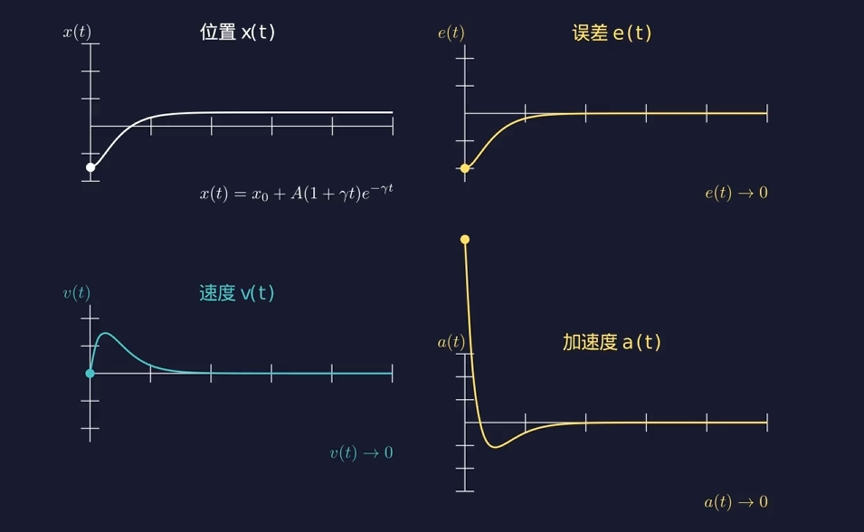

# 从连续控制到四轴飞行器 PID 姿态反馈控制

## 一、 为什么我们需要PID控制？

四轴飞行器是一个典型的**无舵面、靠多电机差异化转速驱动**的系统。它在三维空间中拥有 6 个自由度（3 个位置自由度 $x, y, z$，3 个姿态角自由度：滚转角 Roll $\phi$、俯仰角 Pitch $\theta$、偏航角 Yaw $\psi$），但仅通过 4 个电机的转速（产生 4 个拉力 $F_1, F_2, F_3, F_4$）来进行控制。

这使得四轴飞行器在动力学上是一个**欠驱动、强耦合、非线性且高度不稳定**的系统。

在实际飞行中，哪怕我们给 4 个电机施加完全相同的理论电压，由于以下原因，飞行器也不可能稳定悬停：

- **结构与电气不对称**：电机螺距差异、轴承摩擦不均、电池电压骤降。
- **外部气流扰动**：阵风、地面效应、涡环状态。
- **传感器噪声**：IMU（惯性测量单元）陀螺仪与加速度计的测量高频噪声与零偏。

因此，开环控制在四轴飞行器上是绝对行不通的。我们必须引入**闭环反馈控制**。

### 2. 闭环控制的核心思维：如何消除误差？

我们以四轴飞行器的姿态角控制（以俯仰角 $\theta$ 为例）为例：

- **期望状态（Set Point, $r(t)$）**：遥控器手柄给出的期望俯仰角 $\theta_{d}$（例如 $0^\circ$ 悬停）。
- **测量状态（Process Variable, $y(t)$）**：IMU 经过姿态解算得到的当前实际俯仰角 $\theta$。

我们定义系统在 $t$ 时刻的控制误差为：

$$e(t) = r(t) - y(t) = \theta_d(t) - \theta(t)$$

**控制的核心任务**：寻找一个控制律，根据误差 $e(t)$ 计算出合理的控制量 $u(t)$（最终映射为电机的期望转速或 PWM 信号），使得系统在面对外界扰动时，误差 $e(t)$ 能迅速、平稳、无残留地趋近于 $0$。

**我们想做什么：控制误差 $e(t)$**

**我们有什么：我们能控制电机转速，可以产生纠正力矩**

在探讨四轴飞行器如何稳定前，我们需要先写出它的**转动版牛顿第二定律**。

- **平动**：$F = m \cdot a = m \cdot \ddot{x}$（力 $F$ 产生线加速度 $a$）
- **转动**：$M = I \cdot \alpha = I \cdot \ddot{\theta}$（力矩 $M$ 产生角加速度 $\alpha$）

对于四轴飞行器（以 Pitch 轴俯仰角 $\theta$ 为例）：

- $\theta(t)$ 是飞行器当前的**实际姿态角**，$\theta_0$ 是我们期望的**目标姿态角**（如 $0^\circ$ 悬停）。
- $I$ 是飞行器绕该轴的**转动惯量**（由质量分布决定）。
- $M(t)$ 是左右/前后电机产生差速时施加给机身的**合力矩**（这是我们能直接控制的物理量）。
- 定义 $t$ 时刻的姿态偏差为：$e(t) = \theta_0 - \theta(t)$

## 二、 如何解决这个问题？（PID 控制器的理论演进与推导）

既然我们知道了要消除误差 $e(t)$，那么最自然的想法是：**我们应该如何利用这个误差信息来构建控制量 $u(t)$？**

经典的 PID（Proportional-Integral-Derivative）控制器给出了极具物理直觉且数学上完备的解答：**从“现在”、“过去”和“未来”三个时间维度来协同处理误差。**

### 1. 考虑“现在”：比例项（Proportional Term, P）

如果飞行器向后倾斜了 $10^\circ$（$e(t) = 10^\circ$），控制系统就应该让前推力大于后推力，产生一个反向的纠正力矩 $M_p$。

首先，我们最直观的想法是：**现在的误差有多大，给出的纠正力矩就应该有多大**。

误差小，我们就轻轻“推”（施加力矩）；误差大，推的就重一些。

可以从最简单的数学关系入手：**力矩与误差成正比**。
$$
u_P(t) = K_p e(t)
$$
其中 $K_p$ 为**比例增益**。

- **这样做的结果是什么呢**？

  > 给大家 5 分钟时间，请同学们计算一下

将 $M(t) = I \cdot \ddot{\theta}(t)$ 代入上式：

$$I \cdot \ddot{\theta}(t) = K_p \cdot (\theta_0 - \theta(t))$$

整理得到关于姿态角 $\theta(t)$ 的二阶常系数齐次线性微分方程：

$$\ddot{\theta}(t) + \frac{K_p}{I} \cdot \theta(t) = \frac{K_p}{I} \cdot \theta_0$$

设初始条件为：飞行器从偏斜角 $\theta(0) = A + \theta_0$ 静止释放（$\dot{\theta}(0) = 0$），解此微分方程可得：

$$\theta(t) = \theta_0 + A \cos(\omega t)$$

其中，系统的自然旋转角频率为：$\omega = \sqrt{\frac{K_p}{I}}$

微分方程的解明确表明：**纯 P 控制下，四轴飞行器会在目标角度 $\theta_0$ 两侧做永不停息的“角简谐运动”**

- **为什么会这样？**

  纯 P 控制只看“当前角度在哪里”。当飞行器向目标角度 $\theta_0$ 回正时，随着误差减小，力矩 $M(t)$ 在减小，但**方向一直没变**（始终在加速回正）。

  当达到目标角度 $\theta_0$ 时，虽然 $e(t)=0$ 使得力矩归零，但此时**角速度达到了最大值**！巨大的旋转惯性会冲过头，导致飞行器在另一侧继续过冲，产生剧烈的来回晃动与振荡。

  类似弹簧。

  

  ==演示==

  

## 2. D 控制（微分控制）

### 2.1 思路引入：如何刹车？

为了防止过冲，我们自然地想到，可以根据当前的角速度加入制动机制。当旋转太快时，提前反向打力矩进行“刹车”，来抑制当前过高的角速度。当前角速度越大，这个抑制的力矩就越大，可以假设成正比：

$$M(t) = K_p \cdot e(t) - K_d \cdot \omega(t)$$ 

> 解释一下为什么KP前面是正号，KD前面是负号。

由于 $\frac{de}{dt} = \frac{d(\theta_0-\theta)}{dt} = -\frac{d\theta}{dt} = -\omega(t)$

故 $M(t) = K_p \cdot e(t) - K_d \cdot \dot{\theta}(t) = K_p \cdot e(t) + K_d \cdot \dot{e}(t) $

**这样做的结果是什么呢**？

> 给大家 5 分钟时间，请同学们计算一下

### 2.2 数学推导：阻尼微分方程

现在，我们把带有阻尼的总力矩 $M(t) = K_p(\theta_0 - \theta) - K_d \dot{\theta}(t)$，代回转动动力学方程 $M = I \cdot \ddot{\theta}$ 中：

$$I \cdot \ddot{\theta}(t) = K_p \cdot (\theta_0 - \theta(t)) - K_d \cdot \dot{\theta}(t)$$

将含有 $\theta$ 的项全部移到左边，常数项留在右边，并将两边同时除以转动惯量 $I$：

$$\ddot{\theta}(t) + \frac{K_d}{I} \dot{\theta}(t) + \frac{K_p}{I} \theta(t) = \frac{K_p}{I} \theta_0$$

**为什么加了中间这一项 $\frac{K_d}{I} \dot{\theta}(t)$，系统就不会像纯 P 控制那样无限振荡了？**

在纯 P 控制时，方程是 $\ddot{\theta} + \frac{K_p}{I}\theta = \text{常数}$，特征方程的解是纯虚数 $\pm i\omega$，代表**没有能量衰减的余弦波（简谐运动）**。

而现在，根据微积分求解常系数线性微分方程的标准方法，我们设解的形式为 $\theta(t) = C e^{r t}$，代入齐次方程得到**特征方程**：

$$r^2 + \frac{K_d}{I} r + \frac{K_p}{I} = 0$$

用一元二次方程求根公式解出 $r$：

$$r = \frac{-\frac{K_d}{I} \pm \sqrt{\left(\frac{K_d}{I}\right)^2 - 4\frac{K_p}{I}}}{2}$$

为了式子更简洁，我们令 $\alpha = \frac{K_d}{2I} > 0$（代表衰减速率参数）。判别式 $\Delta = \left(\frac{K_d}{I}\right)^2 - 4\frac{K_p}{I}$ 的正负，直接决定了数学解的形式与物理运动状态。

#### 1. 情况 1：欠阻尼（$\Delta < 0$，即 $K_d < 2\sqrt{K_p I}$）

设阻尼频率 $\omega_d = \frac{1}{2}\sqrt{4\frac{K_p}{I} - \left(\frac{K_d}{I}\right)^2}$，特征根为共轭复根 $r_{1,2} = -\alpha \pm i \omega_d$。

包含特解 $\theta_0$ 的通解形式为：

$$\theta(t) = \theta_0 + e^{-\alpha t} \left( C_1 \cos(\omega_d t) + C_2 \sin(\omega_d t) \right)$$

**代入初始条件求解常数**：

1. **代入角度条件**：

   $$\theta(0) = \theta_0 + e^0 (C_1 \cdot 1 + 0) = \theta_0 + C_1 = \theta_0 + A \implies C_1 = A$$

2. **求一阶导数**：

   $$\frac{\mathrm{d}\theta(t)}{\mathrm{d}t} = -\alpha e^{-\alpha t} (C_1 \cos(\omega_d t) + C_2 \sin(\omega_d t)) + e^{-\alpha t} (-\omega_d C_1 \sin(\omega_d t) + \omega_d C_2 \cos(\omega_d t))$$

3. **代入角速度条件 $\frac{\mathrm{d}\theta(0)}{\mathrm{d}t} = 0$**：

   $$\frac{\mathrm{d}\theta(0)}{\mathrm{d}t} = -\alpha C_1 + \omega_d C_2 = 0 \implies C_2 = \frac{\alpha A}{\omega_d}$$

**特解表达**：

$$\theta(t) = \theta_0 + A \cdot e^{-\frac{K_d}{2I} t} \left( \cos(\omega_d t) + \frac{K_d}{2 I \omega_d} \sin(\omega_d t) \right)$$

- **物理本质**：包含余弦波与衰减项 $e^{-\alpha t}$。飞行器**穿过目标角度产生过冲与来回震荡，但由于阻尼不断吸收能量，振幅等比衰减，最终停在 $\theta_0$**。

> 为什么物理上会“过冲并震荡”？

看看上面的数学表达式，它由两部分乘积组成：

- **$\cos(\omega_d t + \phi)$（正弦/余弦周期波）**：由于阻尼 $K_d$ 太小，不足以在飞行器到达 $0^\circ$ 前把旋转动能完全吸收。飞行器冲过头后，P 项（弹簧力）开始反向拉，又把它拉回来，导致物理上必然产生**来回晃动**。
- **$e^{-\alpha t}$（衰减因子）**：因为 $\alpha = \frac{K_d}{2I} > 0$，所以指数项是一个随着时间 $t$ 增加而逐渐趋近于 0 的**衰减包络线**。

**物理图像总结**：

正弦波负责“来回过冲震荡”，包络线 $e^{-\alpha t}$ 负责“限制震荡幅值”。波峰受限于指数包络线，因此**振幅一次比一次小，呈现出等比衰减的波形，最终收敛到目标角度**。

==演示==

需要调节不同的Kd，给出四个坐标系曲线：x(t), e(t), v(t), a(t)

#### 2. 情况 2：临界阻尼（$\Delta = 0$，即 $K_d = 2\sqrt{K_p I}$）

特征方程解出重根：$r_1 = r_2 = -\alpha = -\frac{K_d}{2I}$。

通解形式为：

$$\theta(t) = \theta_0 + (C_1 + C_2 t) e^{-\alpha t}$$

**代入初始条件求解常数**：

1. **代入角度条件**：

   $$\theta(0) = \theta_0 + C_1 = \theta_0 + A \implies C_1 = A$$

2. **求一阶导数**：

   $$\frac{\mathrm{d}\theta(t)}{\mathrm{d}t} = C_2 e^{-\alpha t} - \alpha (C_1 + C_2 t) e^{-\alpha t}$$

3. **代入角速度条件 $\frac{\mathrm{d}\theta(0)}{\mathrm{d}t} = 0$**：

   $$\frac{\mathrm{d}\theta(0)}{\mathrm{d}t} = C_2 - \alpha C_1 = 0 \implies C_2 = \alpha A$$

**特解表达**：

$$\theta(t) = \theta_0 + A \left( 1 + \frac{K_d}{2I} t \right) e^{-\frac{K_d}{2I} t}$$

- **物理本质**：没有虚数与正弦项，**完全不过冲、不振荡，以最快速度单调平滑收敛至目标姿态 $\theta_0$**（调参追求的最佳状态）。

> 为什么物理上“既不过冲，速度又最快”？

- **完全没有虚数，代表没有 $\sin/\cos$ 项**：从数学上直接切断了周期性振荡的根源，飞行器**绝对不会冲过头**。
- **$(1 + \alpha t) e^{-\alpha t}$ 的数学特性**：对于 $t > 0$，函数值单调衰减，且衰减极快。
- **临界点优势**：此时的 $K_d$ 刚好达到了“把过冲完全压制”所需的最小阻尼量。它既没有因为阻尼不够而冲过头，也没有因为阻尼过大而拖慢系统的响应速度。

**物理图像总结**：

飞行器从初始角度被释放后，像一块被精准控制的平滑机械臂，**以最快的时间单调上升，平滑吸附到目标角度上，过程零振荡、零超调**。

#### 3. 情况 3：过阻尼（$\Delta > 0$，即 $K_d > 2\sqrt{K_p I}$）

特征方程解出两个负实根 $r_1 = -\alpha + \beta, r_2 = -\alpha - \beta$（其中 $\beta = \sqrt{\alpha^2 - \frac{K_p}{I}} < \alpha$）。

通解形式为：

$$\theta(t) = \theta_0 + C_1 e^{(-\alpha + \beta)t} + C_2 e^{(-\alpha - \beta)t}$$

**代入初始条件求解常数**：

1. **代入角度条件**：

   $$\theta(0) = \theta_0 + C_1 + C_2 = \theta_0 + A \implies C_1 + C_2 = A$$

2. **代入角速度条件 $\frac{\mathrm{d}\theta(0)}{\mathrm{d}t} = 0$**：

   $$\frac{\mathrm{d}\theta(0)}{\mathrm{d}t} = (-\alpha + \beta) C_1 + (-\alpha - \beta) C_2 = 0$$

3. **联立方程组解得**：

   $$C_1 = \frac{\alpha + \beta}{2\beta} A, \quad C_2 = \frac{\beta - \alpha}{2\beta} A$$

**特解表达**：

$$\theta(t) = \theta_0 + \frac{A}{2\beta} \left[ (\alpha + \beta) e^{-(\alpha - \beta)t} + (\beta - \alpha) e^{-(\alpha + \beta)t} \right]$$

- **物理本质**：阻尼过大使得慢衰减项 $e^{-(\alpha - \beta)t}$ 主导过程，飞行器**移动极度缓慢，耗费极长的时间才能爬升回目标角度 $\theta_0$**。

> 为什么物理上会“像陷在浓稠蜂蜜里一样缓慢”？

注意这两个衰减速率：$\lambda_1$ 和 $\lambda_2$。

- $\lambda_2 = \alpha + \sqrt{\dots}$ 很大，导致 $e^{-\lambda_2 t}$ 衰减极快，很快就衰减到 0 了。

- **关键看 $\lambda_1$**：$\lambda_1 = \alpha - \sqrt{\left(\frac{K_d}{2I}\right)^2 - \frac{K_p}{I}}$。当 $K_d$ 变得极大时，$\sqrt{\left(\frac{K_d}{2I}\right)^2 - \frac{K_p}{I}} \approx \frac{K_d}{2I} = \alpha$，这使得：

  $$\lambda_1 \to 0$$

主导系统后半程运动的是 $e^{-\lambda_1 t}$。当指数项的系数 $\lambda_1$ 趋近于 0 时，$e^{-\lambda_1 t}$ 的衰减速度会**变得极其缓慢**！

**物理图像总结**：

阻尼力矩 $M_{damp} = -K_d \dot{\theta}$ 实在太大了。飞行器稍有一点旋转速度，巨大的 D 项就会施加极强的反向制动力。飞行器就像被卡在黏稠的蜂蜜里，P 项（弹簧拉力）费尽九牛二虎之力也拉不动它，导致**系统响应极其迟钝，要耗费极长的时间才能爬升到目标角度**。

## 3. I 控制（积分控制）

问题就是存在稳态误差之后，会长时间无法消除，需要发现“误差长时间存在”这一点进行调节。